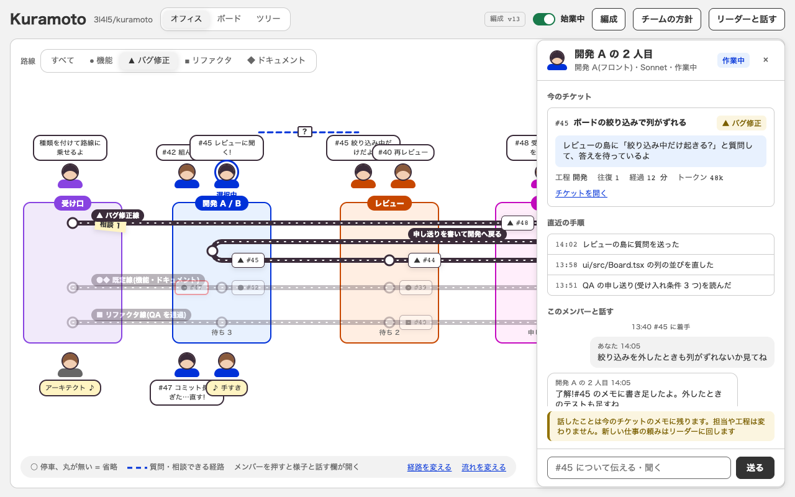
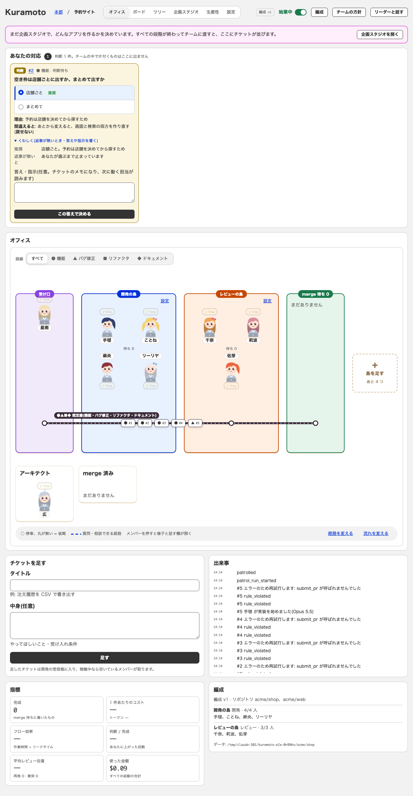
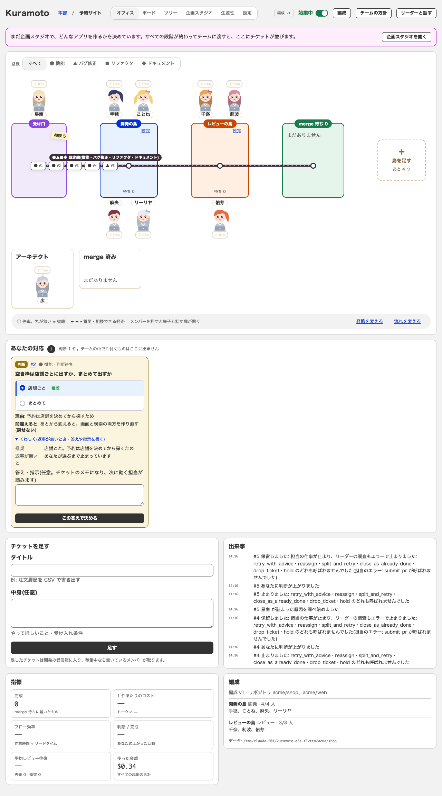
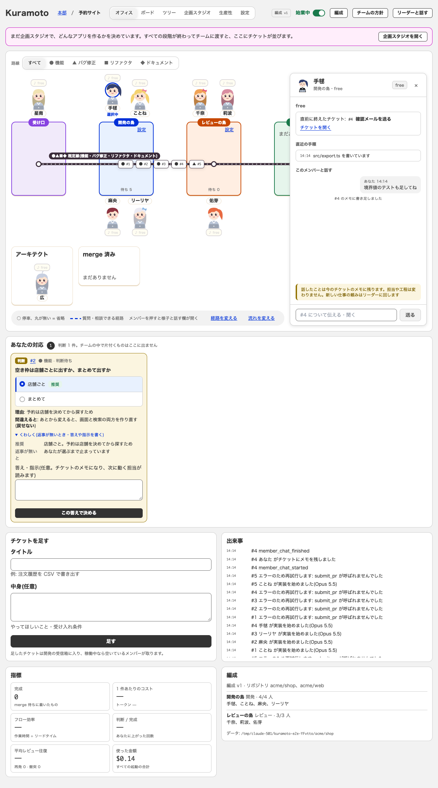
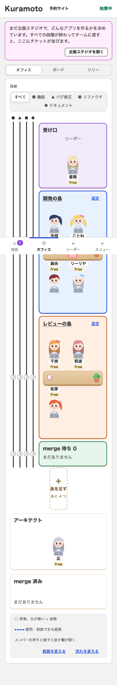
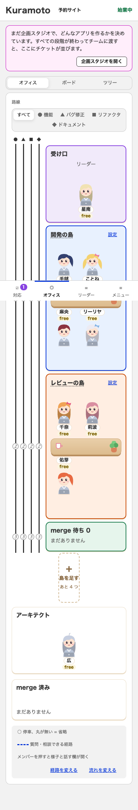

# #109 パソコン幅のオフィスを試作(office)に合わせる

画面はフェイクの担当で動かしたアプリ(`E2E_SCREENS=1 npx tsx e2e/server.ts`、始業した状態)を `render_page` で撮った。
URL は `?tab=office&view=floor#/p/1`。直す前は main の画面、直した後はこの PR。

| 画面 | 試作 | 直す前 | 直した後 |
|---|---|---|---|
| オフィス 1280px |  |  |  |
| メンバーを開いた 1280px | (試作の右の引き出し) | — |  |
| オフィス 390px(スマホ) | — |  |  |

- 390px: 初回の撮影では「直す前」と「直した後」がバイト単位で同じだった。レビュー対応後の「直した後」は、フェイクの担当が動いて画面のデータ(チケットの居場所など)が進んだ状態で撮り直したので、画像は同じではない(CSS はスマホ幅に触れていない)。
- メンバーを開いた画像は、レビュー対応の前(島の箱が 160px 固定だったとき)に撮ったもの。箱の幅は 1 段の人数に合わせて広がるようにしたので、開発の島は約 168px になっている。撮るためだけに `?member=1` で開く一時のパッチを当てて撮った(そのパッチはコミットしていない)。
- 試作は 1 画面が「ヘッダー + 床」だけ(800px)。実際の画面は、その下に「あなたの対応」「チケットを足す」「出来事」「指標」「編成」が続くので、`compare_screen` の割合(11.5% → 11.7%)と高さは試作に近づかない。床の部分の形は、上の画像で見比べる。

## ずれの一覧(PR の本文と同じ)

### 直したもの

| # | ずれ | 試作 | 直す前 | 直した後 |
|---|---|---|---|---|
| 1 | 島の箱の作り | 幅 160px・高さ 228px の「路線が通る帯」。メンバーは箱の上と下に立つ | 箱が 440px 近くあり、メンバー・机・路線が箱の中 | 箱を帯だけにし、メンバーと吹き出しは箱の上(上の段)・下(下の段)。路線は箱の中。箱の幅は 160px を下限に、1 段の人数(席 76px)に合わせて広がる |
| 2 | 島の間隔 | 間をあける | 幅が伸びて詰まる | 受け口 160px・merge 待ち 180px・間 96px |
| 3 | 床の位置 | ヘッダーのすぐ下が床 | 企画スタジオの案内・あなたの対応が床より上 | オフィス(床)の見方のときだけ、床を先頭(案内の次)にし、あなたの対応などは床の下。JSX の並びを替えたので、Tab・読み上げの順も見た目と同じ。ボード・ツリーとスマホは今までどおり |
| 4 | 床の外の枠 | 枠が 1 重 | 「オフィス」の見出し付きの白い枠の中に床の枠(二重) | パソコンのみ、外の枠と見出しを出さない(名前は aria-label) |
| 5 | 路線の絞り込みの色 | 外枠が白・選択が灰+影 | 逆(外枠が灰・選択が白) | 試作どおり |
| 6 | 受け口の付箋 | 「相談 N」の黄色い付箋 | なし | 判断待ちがあれば付箋で出す |

### 直さなかったもの(理由)

| ずれ | 理由 |
|---|---|
| 床の下に「あなたの対応」「チケットを足す」「出来事」「指標」「編成」が続く(高さ 800px → 約 2300px。`compare_screen` の割合は 11.5% → 11.7%) | 試作は「ヘッダー + 床」の 1 画面で、これらは試作に無い機能の区画。割合は床の形の改善を表さない |
| 「あなたの対応」が床の下に回ったこと | 試作に合わせた(#3)。見落とさないよう、受け口の付箋(相談 N)を足した。戻すときは Project.tsx の並びを戻す |
| アーキテクトが枠つきの机のまま(試作は受け口の下に立つメンバー) | 机の相談の線・名前・状態の読み上げが机に結び付いている。人として立たせるのは別のチケットで決める |
| 「merge 済み」の枠・試作に無い「島を足す」 | 試作に無い機能(merge 済みの件数・島の追加)。残した |
| ヘッダーの「本部 / プロジェクト名」・切り替えスイッチの 6 項目 | #88 で決めた。#105 のログアウトとぶつからないよう触っていない |
| 凡例の位置(試作は床の中の左下に重ねる) | 今は床の下の行。引き出しが開くと幅を詰める(#72)ので残した |
| 空席(点線の丸) | 島の人数を見せるために必要 |
| 「始業中 / 終業中」「編成 v1」 | 実データの状態の違い |
