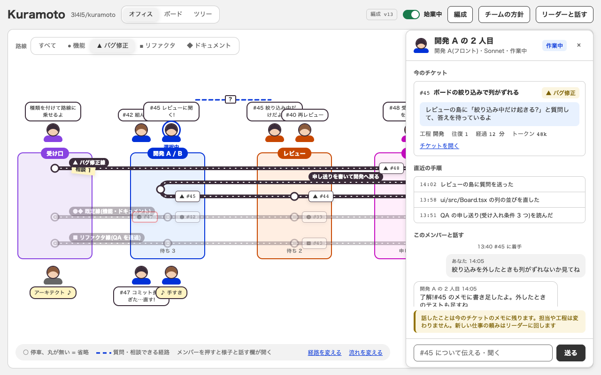
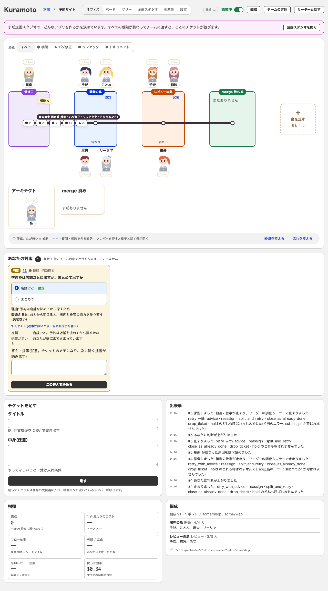
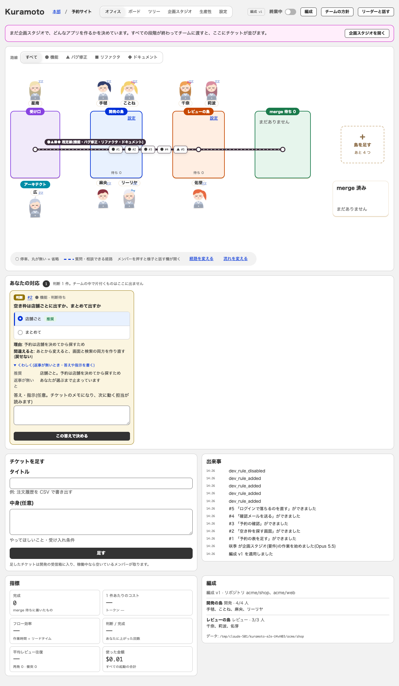
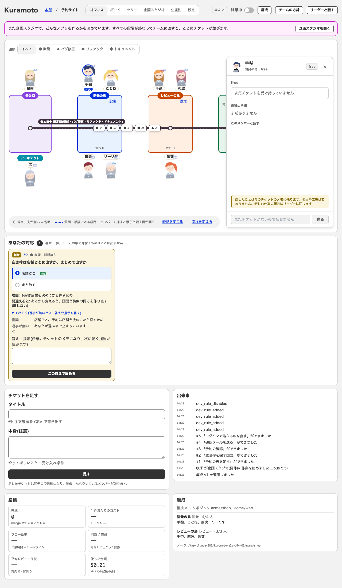
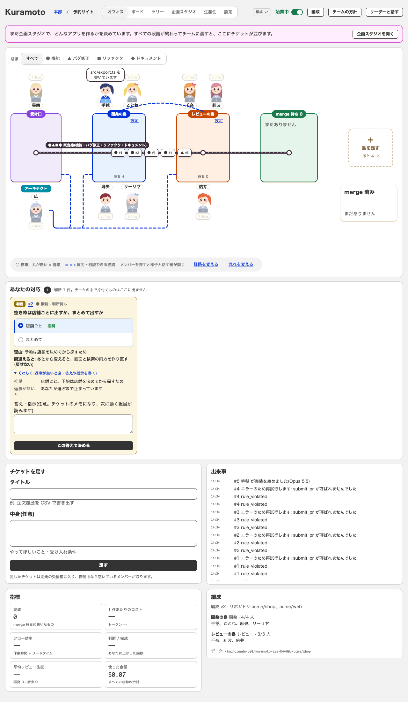
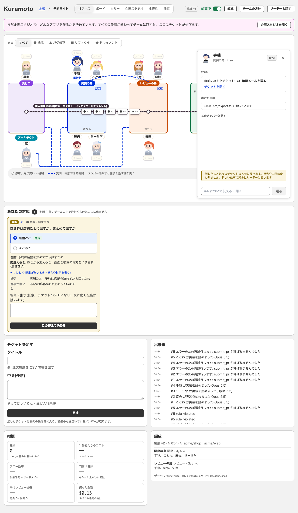
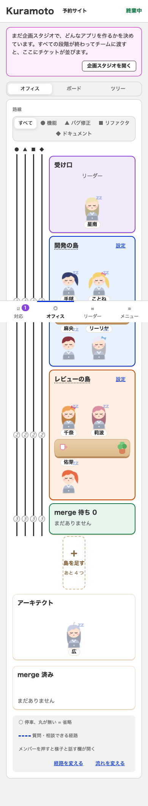

# #113 パソコンのオフィス: アーキテクトを受け口の下に立つメンバーにし、凡例を床の左下に重ねる

#109(PR #95)で「直さなかったもの」に残した 2 つのずれを、試作(office)に合わせた。画面はフェイクの担当で動かしたアプリ(`E2E_SCREENS=1 npx tsx e2e/server.ts`)を `render_page` で撮った。URL は `?tab=office&view=floor#/p/1`。

| 画面 | 試作 | 直す前(#109 の後) | 直した後 |
|---|---|---|---|
| オフィス 1280px |  |  |  |
| メンバーを開いた 1280px | (試作の右の引き出し) | — |  |
| 経路のあるデータ 1280px(開発↔アーキテクト・レビュー↔アーキテクト・受け口↔アーキテクト・開発↔レビュー。始業中) | — | — |  |
| 経路のあるデータで、メンバーを開いた 1280px | — | — |  |
| オフィス 390px(スマホ・変えていない) | — | — |  |

- メンバーを開いた画像は、撮るためだけに `?member=1` で開く一時のパッチを当てて撮った(そのパッチはコミットしていない)。
- 「直す前」は #109 の画像(`docs/screenshots/109/office-after-1280.png`)の複製。始業の状態が違うため、メンバーの表情(居眠り / 起きている)は揃っていない。

## 直したもの

| # | ずれ | 試作 | 直す前 | 直した後 |
|---|---|---|---|---|
| 1 | アーキテクト | 受け口の箱の下に、人として立つ(枠つきの机は無い) | 床の下の行に、枠・影つきの机(「アーキテクト」の見出し付き) | 枠・影・背景を出さず、受け口の真下(幅 160px)に立たせる。島の下の段のメンバーと同じ向き(名札が上、吹き出しが下)。役割名は青緑の丸いラベル |
| 2 | 凡例 | 床の中の左下に重なる | 床の下の行(床の中の、島と merge 済みの下) | 床の底の左下に重ねる(`position: absolute`)。メンバー・吹き出しとは重ならない |

### 机の相談の線・読み上げ・引き出し(壊していないもの)
- DOM は変えていない。アーキテクトは今までどおり `<section class="of-desk" data-loc="arch" aria-label="アーキテクトの机">`。相談の線(`ask()`)の端 `data-loc="arch"`、名前・状態の読み上げ(`Person` の aria-label)、Tab の順はそのまま。
- 床の下の行(`of-side`)を、島の下の段の高さまで CSS で引き上げて、受け口の真下に置いた。座標は `data-loc` の実測なので、線は今までどおり引かれる。
- 引き出しを開いたときに凡例の幅を詰める動き(#72)は、新しい置き方でも保つ。開いている間は、凡例を流れの中に戻し、引き出しの手前(400px + 余白)までにする。
- **アーキテクトへの相談の線**: アーキテクトが受け口の真下に立つので、旧来の「箱の底 → アーキテクトの上」の直線は 8px ほどの切れ端になる(レビュー指摘)。`ask()` の arch の枝を作り直し、相手の箱の外側の縁(島は左、受け口は右)から出て、箱どうしのすき間を下り、島の下の段のメンバー・吹き出しの下(`OF_BELOW` - 4px)を通って、アーキテクトの右横に着く(上の「経路のあるデータ」の画像)。下の段のメンバーの真上は通らない。e2e で、アーキテクトへの経路の長さ(120px 超)と、メンバー・名札・吹き出しの上を通らないことを確かめる。
- 凡例は、幅 1001px 以上で引き出しが閉じているときだけ床の左下に重ねる。狭い幅(701〜1000px)や引き出しが開いている間は、今までどおり流れの中(アーキテクトの下の行。引き出しの手前まで)に置く。凡例が何行にも折り返してアーキテクト・吹き出しに重なるのを避けるため(レビュー提案)。
- 床が横にあふれるとき(島が多いとき)も、床の下の段が島と同じ幅になるよう、地図を grid にした(merge 済みの山は同じ段の右端)。
- スマホ(700px 以下)は変えていない(上の 390px の画像。アーキテクトは枠つきの机、凡例は下の行のまま)。

## 直さなかったもの / 試作との違い

| ずれ | 理由 |
|---|---|
| merge 済みの山 | 試作に無い区画。アーキテクトと同じ段の右端に置いた(位置は試作に無い) |
| アーキテクトの吹き出し | 試作は free のとき「アーキテクト ♪」。実装は役割名を上のラベルに出し、吹き出しは他のメンバーと同じ「♪ free」/ 今していること |
| 床の高さ | 試作は「ヘッダー + 床」の 1 画面(800px)。実際の画面は、床の下に「あなたの対応」などが続く(#109 と同じ) |
