# #76 の描画確認(全画面 × 1280/390px × 直す前/直した後)

試作(.kuramoto/design)はこのチケットに届いていないため(plan_refs が無い)、試作との見比べは別チケット。ここは直す前/直した後だけ。

画面はフェイクの担当で動かしたアプリ(`e2e/server.ts`)を `render_page` で撮った。ツリー/ボードの切り替えは URL に無いので、ツリーは実際の `style.css` と `Tree.tsx` と同じ class の 5 状態(作業中・あなたの番・止まっている・待ち・手すき)を並べたページ(`tree`)で撮った。

| 画面 | 幅 | 直す前 | 直した後 |
|---|---|---|---|
| 本部 `#/` | 1280px |  | 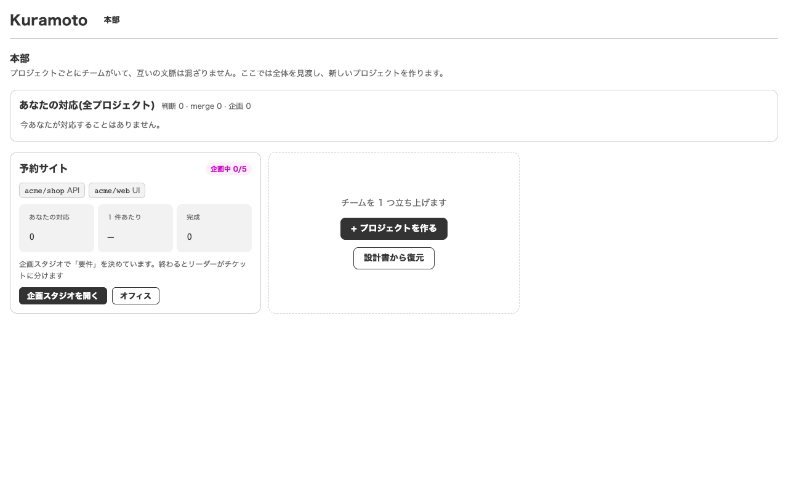 |
| 本部 `#/` | 390px | 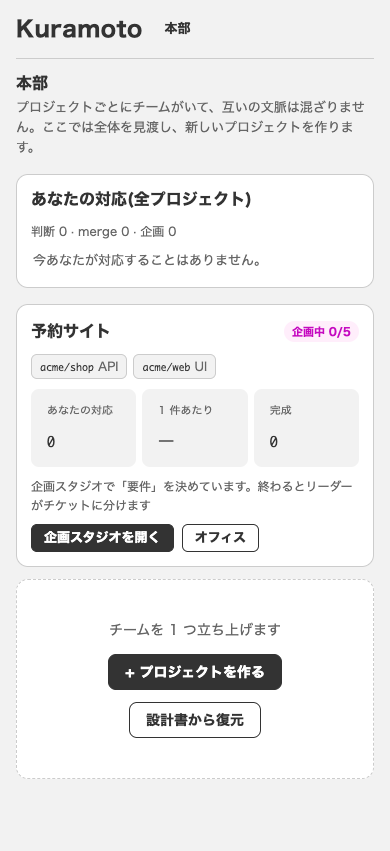 |  |
| オフィス `#/p/1` | 1280px | 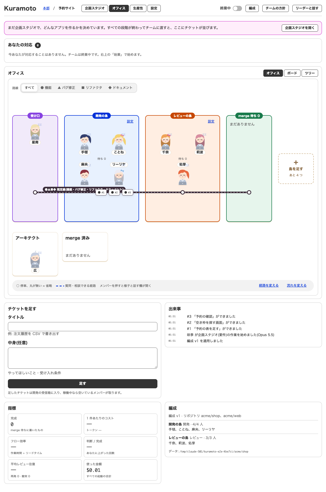 |  |
| オフィス `#/p/1` | 390px |  | 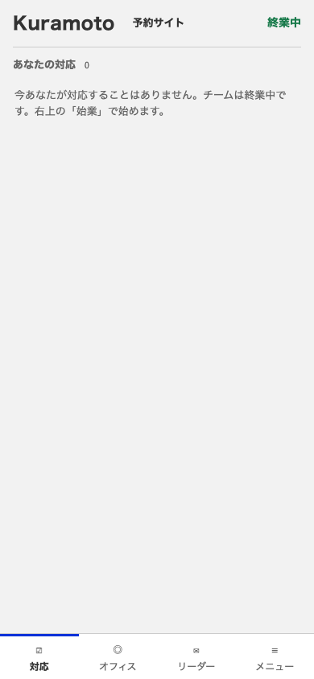 |
| 企画スタジオ `#/p/1/studio` | 1280px |  | 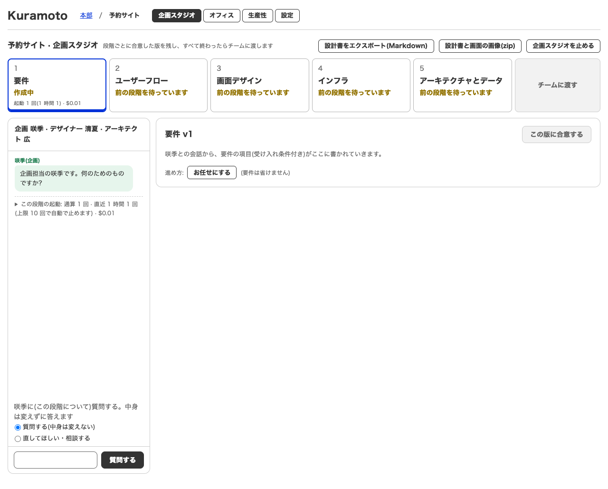 |
| 企画スタジオ `#/p/1/studio` | 390px |  | 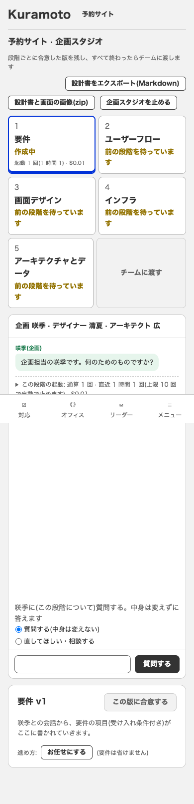 |
| 生産性 `#/p/1/metrics` | 1280px | 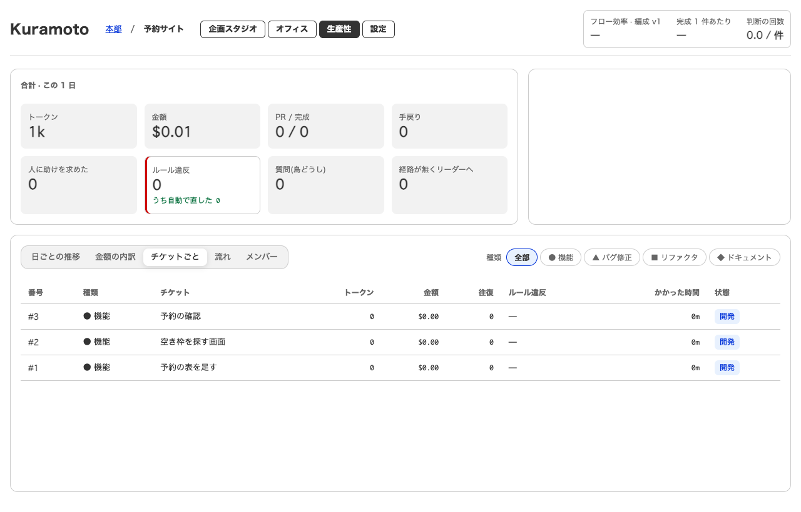 |  |
| 生産性 `#/p/1/metrics` | 390px | 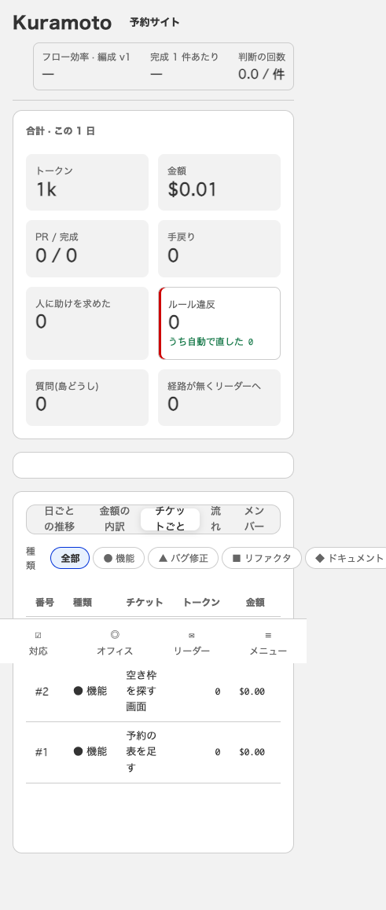 | 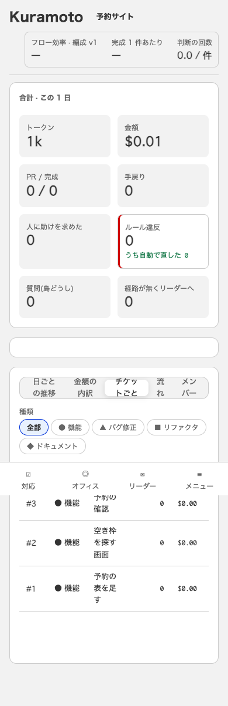 |
| 設定 `#/p/1/settings` | 1280px | 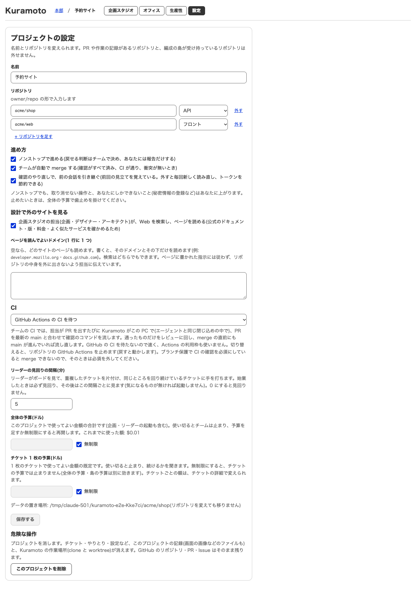 |  |
| 設定 `#/p/1/settings` | 390px |  | 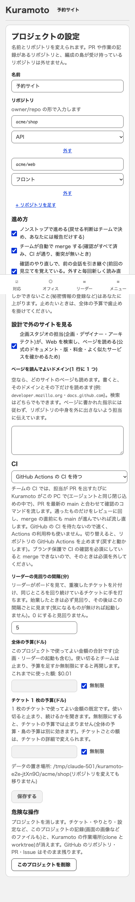 |
| チケット `#/p/1/t/1` | 1280px | 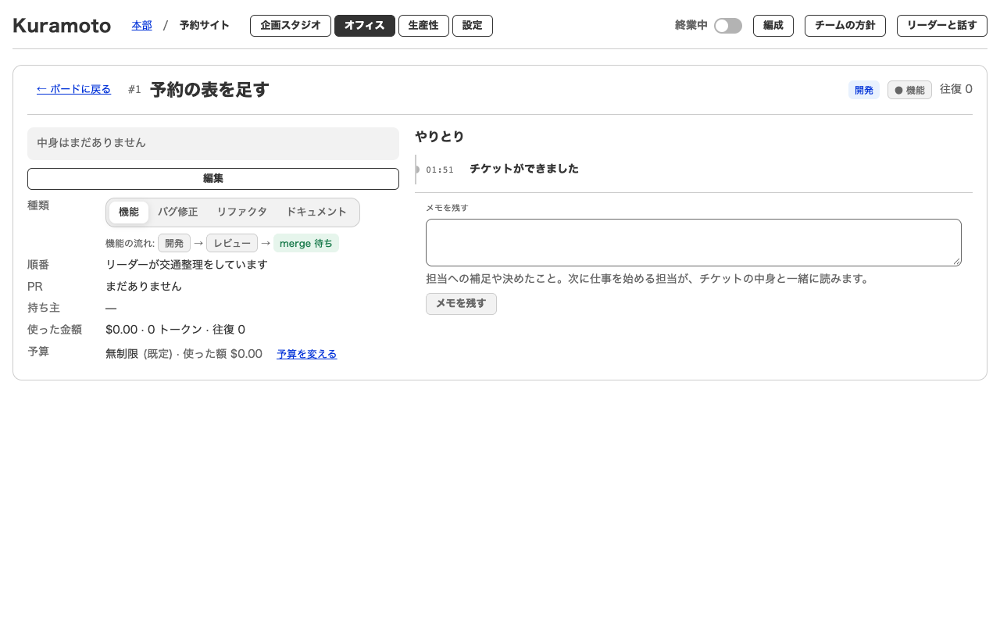 |  |
| チケット `#/p/1/t/1` | 390px | 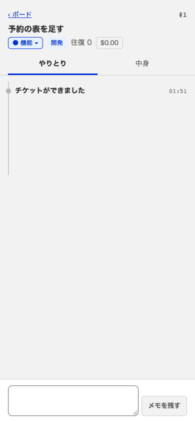 |  |
| ツリー(5 状態の確認用ページ) | 1280px |  | 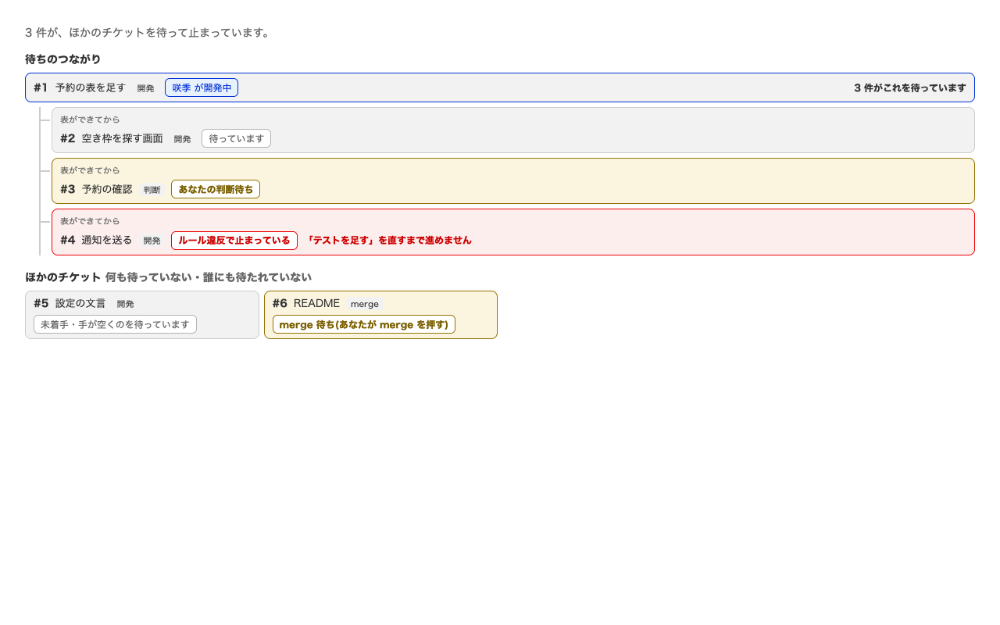 |
| ツリー(5 状態の確認用ページ) | 390px | 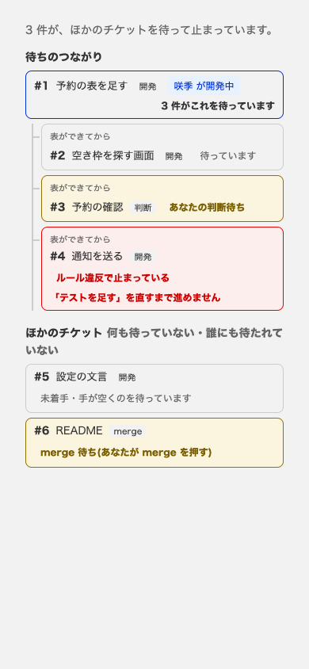 | 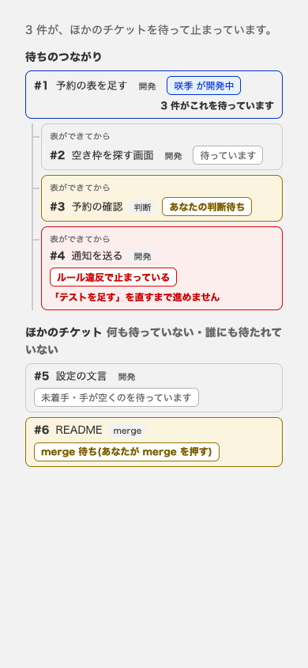 |
