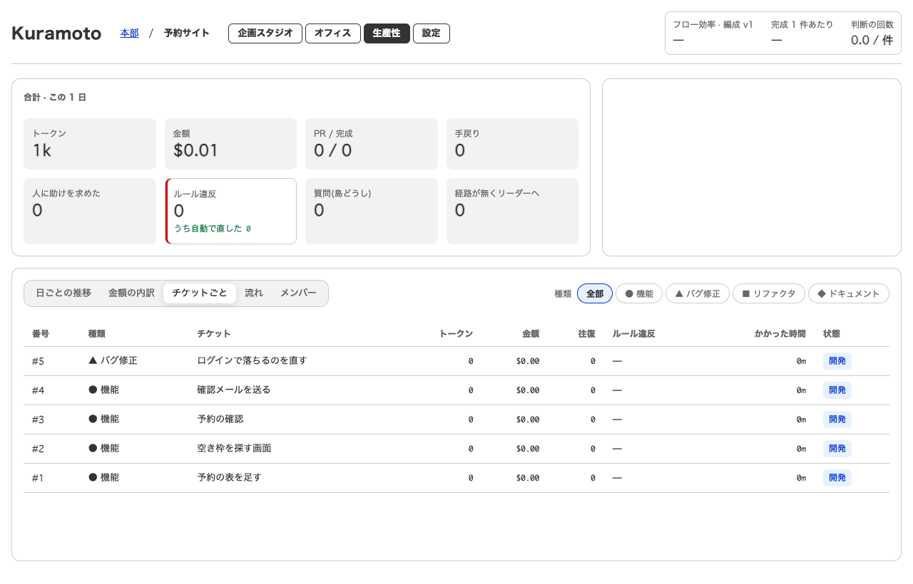
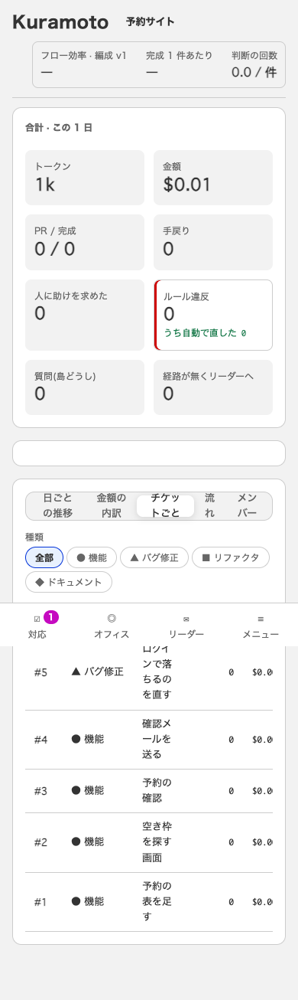
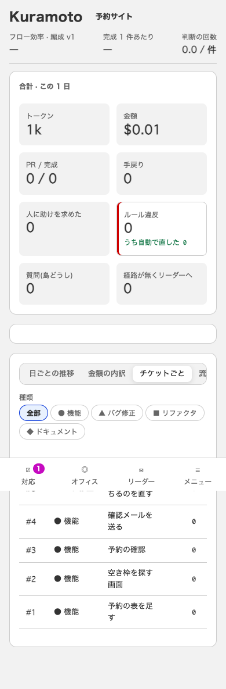
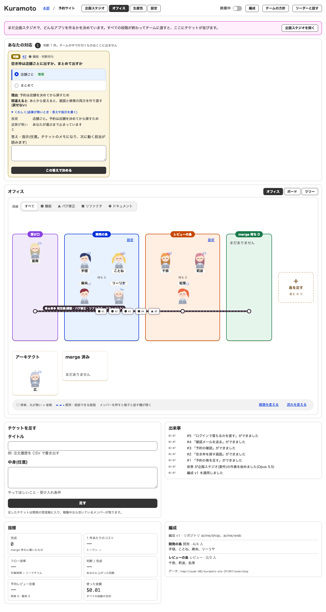
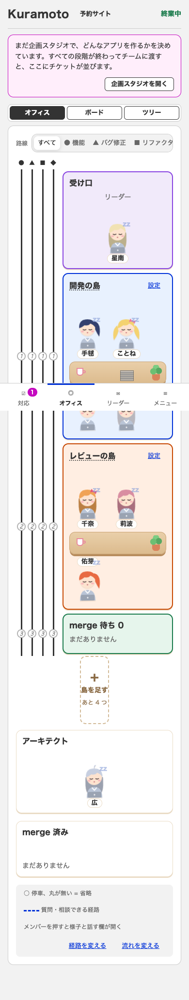
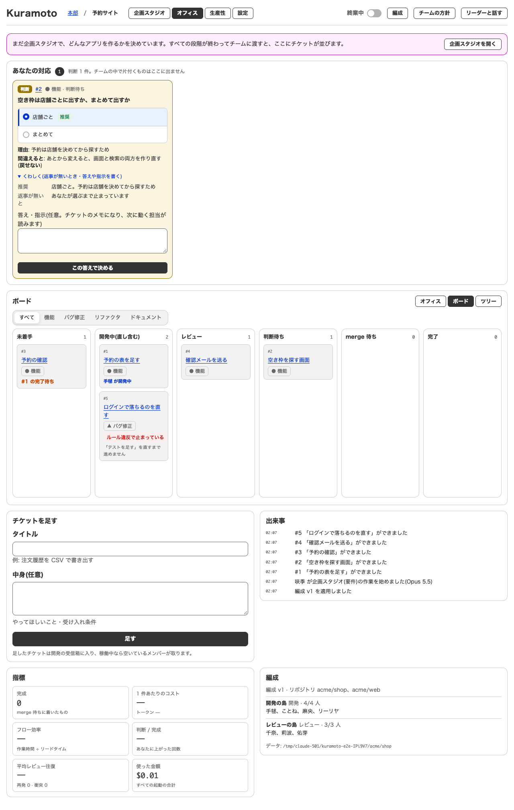
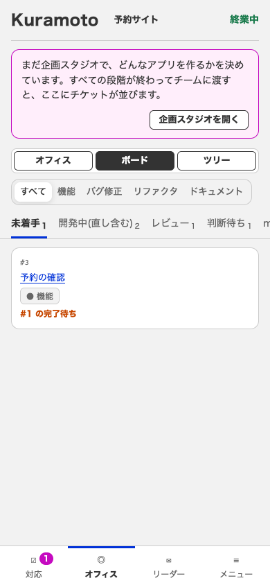
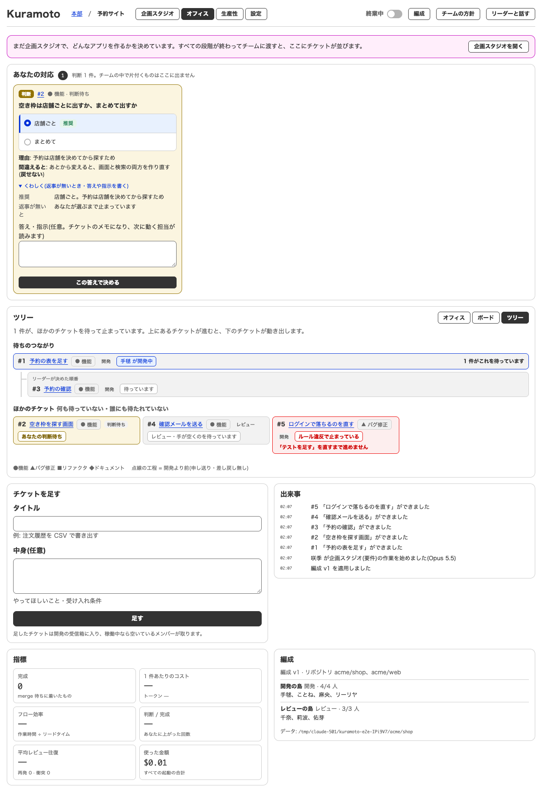
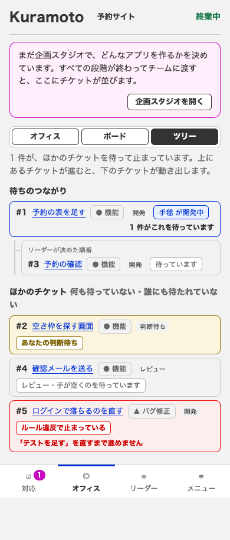

# #78 の描画確認(生産性・オフィス・ボード・ツリー × 1280/390px × 直す前/直した後)

試作(全画面の `<key>.html`)はこのチケットに届いていない(plan_refs に allScreens が無い)。試作との見比べ(compare_screen)は、切り出した続きのチケットで行う。ここは直す前/直した後だけ。

## 撮り方(撮り直せる)

```sh
npm run build:ui
E2E_SCREENS=1 E2E_PORT=4478 E2E_WEB_DIR=ui/dist npx tsx e2e/server.ts
```

`E2E_SCREENS=1` で、プロジェクト「予約サイト」とチケット 5 件を作り、ツリー・ボードの 5 状態(作業中・あなたの番・止まっている・待ち・手すき)を `e2e/screens.ts` のフェイクのデータで出す。
撮る URL(`render_page` に渡す。ボード・ツリーの切り替えは `?tab=office&view=board|tree` で指定する):

- 生産性: `http://localhost:4478/#/p/1/metrics`
- オフィス: `http://localhost:4478/?tab=office&view=floor#/p/1`
- ボード: `http://localhost:4478/?tab=office&view=board#/p/1`
- ツリー: `http://localhost:4478/?tab=office&view=tree#/p/1`

| 画面 | 幅 | 直す前 | 直した後 |
|---|---|---|---|
| 生産性 | 1280px |  |  |
| 生産性 | 390px |  |  |
| オフィス(路線図) | 1280px |  |  |
| オフィス(路線図) | 390px |  |  |
| オフィス「ボード」 | 1280px |  |  |
| オフィス「ボード」 | 390px |  |  |
| オフィス「ツリー」 | 1280px |  |  |
| オフィス「ツリー」 | 390px |  |  |
