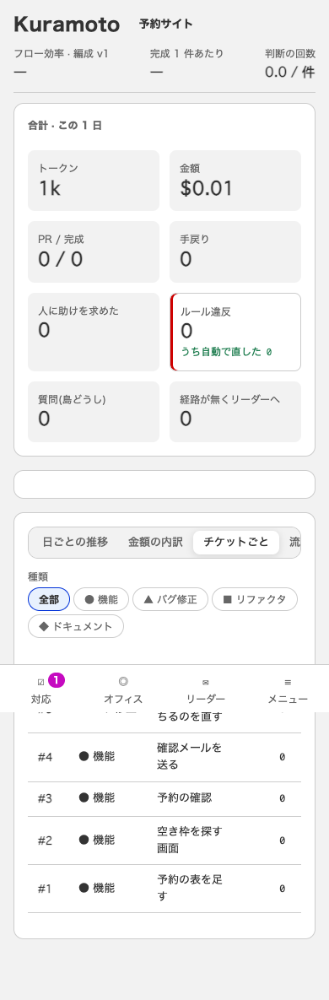
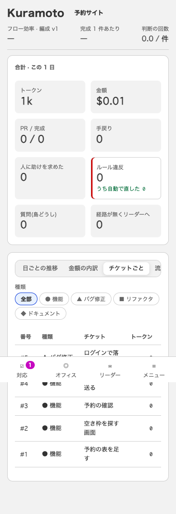

# #81 生産性(390px): 中身の無い枠

原因: 「フロー効率の推移」のパネルは、効率の記録も編成の版も無いと、中の図が何も描かない(`null`)のに、外の枠(`.panel`)だけ残っていた。
直し方: 推移に並ぶ日が 1 つも無いときは、枠ごと出さない(`ui/src/Productivity.tsx` の `efficiencyDays`)。

撮り方は [../78/README.md](../78/README.md) と同じ(生産性: `http://localhost:4478/#/p/1/metrics`)。

| 画面 | 幅 | 直す前(#78 の直した後と同じ) | 直した後 |
|---|---|---|---|
| 生産性 | 390px |  |  |
