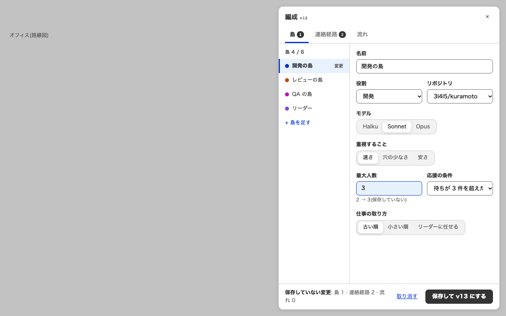
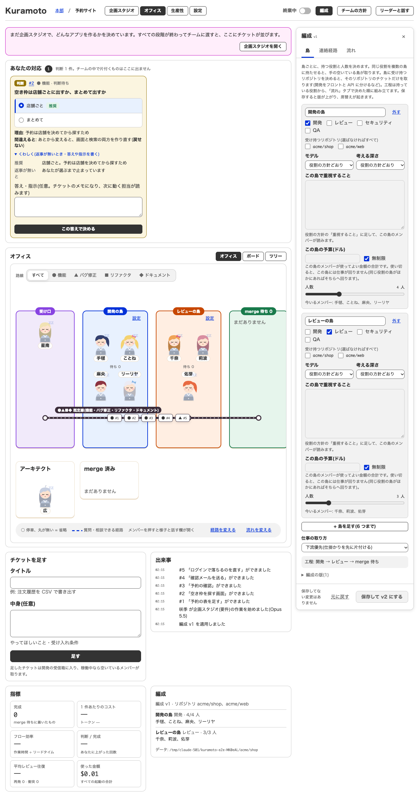
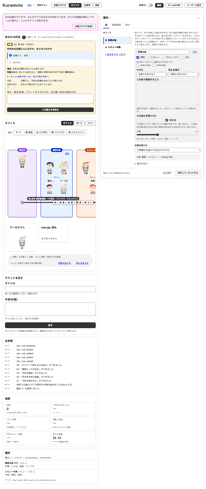
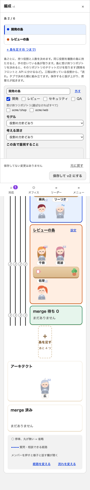

# #82 編成「島」タブ(左に島の一覧・右に編集)

試作 / 直す前 / 直した後。撮り方は `docs/screenshots/80/README.md` と同じ(`?tab=office&drawer=formation&dtab=islands#/p/1`)。

| 画面 | 幅 | 試作 | 直す前 | 直した後 |
|---|---|---|---|---|
| 編成「島」 | 1280px |  |  |  |
| 編成「島」(スマホ) | 390px | なし | なし |  |

## 試作との違い

- 試作は画面の上に重なる窓(うしろを暗くする)だが、実装は画面の右の列に出す引き出しのままにした。連絡経路タブは「保存前の案」を
  オフィスの床に点線で重ねて見せるので、窓でうしろを覆うとそれが見えなくなる。3 タブ(下の帯・タブの札)は同じ部品を使っている。
- 試作の項目(役割の選択・モデルの切り替え・最大人数・応援の条件・仕事の取り方の 3 択)は試作用の見本で、実際の編成の項目とは違う。
  右の編集は、今ある項目(役割・リポジトリ・モデル・考える深さ・重視すること・予算・人数)をそのまま使う。
- 一覧の色の点は、島の最初の役割の色(開発・レビュー・QA・セキュリティ)。試作は島ごとに別の色。
- 「仕事の取り方」と工程・版の履歴は島ごとでなく編成全体の設定なので、右の下に置いた。
