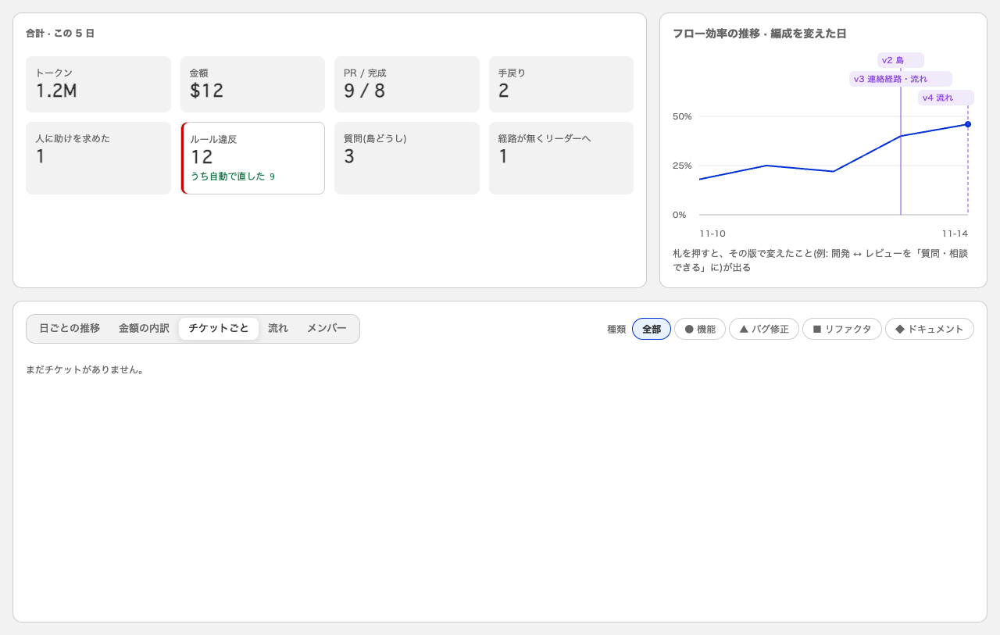
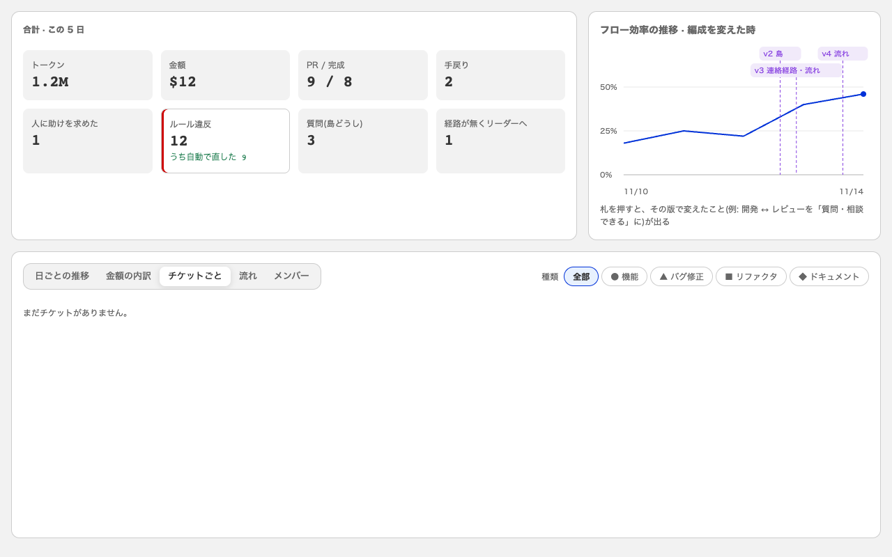
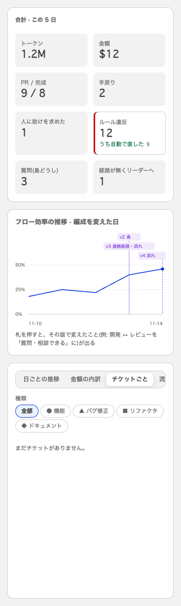
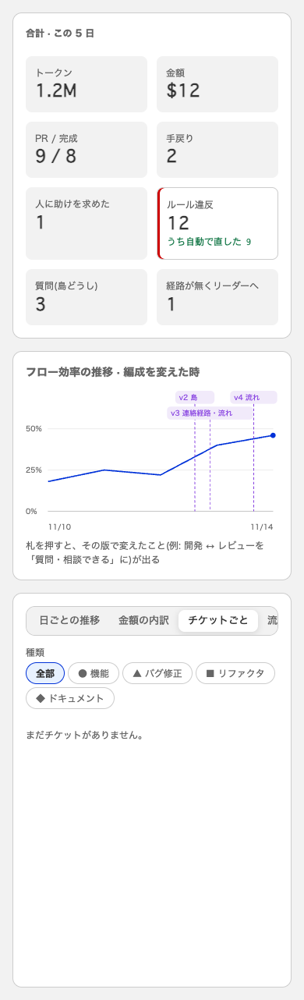

# #94 フロー効率の推移: 編成を変えた印を、日ではなく時刻の位置に置く

横軸を日の並びから、時刻の連続した軸(`ui/src/efficiencyAxis.ts`)にした。版が上がった時刻(`formationMarks[].at`)の位置に縦の点線と札を置くので、同じ日に何度変えても別の位置に出る。
効率の点は日ごとの集計のまま、その日の最後の merge の時刻(`efficiencyDaily[].at`)に置く。

撮り方: 作業場所で `vite` を動かし、`ui/src/Productivity.tsx` の `ProductivityPage` に、固定のデータ(11/13 09:00 の v2、11/13 15:30 の v3、11/14 10:05 の v4)を返す `fetch` を差して描いた(確認用の入口で、コミットには入れていない)。
直す前は、11/13 の v2 と v3 が同じ位置の線に重なる。

| 幅 | 直す前 | 直した後 |
|---|---|---|
| 1280px |  |  |
| 390px |  |  |
